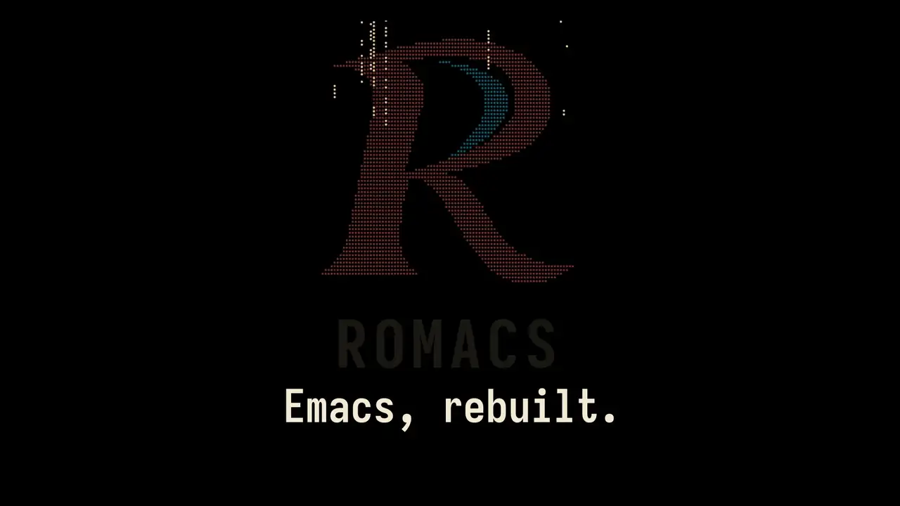

<!-- perfbench-lead-begin -->
# Romacs

<a href="https://thanosapollo.org/romacs/romacs.mp4"></a>

Emacs Lisp on a new machine: a Rust runtime, a GPU-rendered display, and worker
VMs that keep you typing while real work runs beside it.  Your packages, your
init and your muscle memory come with you.

| | Romacs | GNU Emacs |
| --- | ---: | ---: |
| Log the entire Emacs history, 183,254 commits | **2.82 s** | 18 s |
| Open a 15 MB C header, tree-sitter in both | **1.05 s** | 1.94 s |
| Open `xdisp.c`, tree-sitter in both | **228 ms** | 433 ms |
| Switch themes | **4.5 ms** | 23.7 ms |
| Uncompiled Lisp, one function call | **16.2 ns** | 257 ns |

The clip is the real program; the race runs at real speed.  Every number, losses
included, is in [doc/benchmarks.md](doc/benchmarks.md).

- **Worker VMs.**  Searches, syncs and background loads run off the main VM, and
  `C-g` reaches long work.
- **Agents.**  Claude and Codex in real chats, with every buffer, window and
  process open to them through Lisp and MCP.  Inspired by T3 Code's orchestration,
  and T3 Code's providers work here too.
- **GPU rendering.**  Animation, floating completion and dozens of colour schemes.
  On Omarchy it follows your desktop theme.
- **Still Emacs.**  GNU's Lisp runs on it, and GNU's own test suite keeps it honest.
<!-- perfbench-lead-end -->

## Install

```sh
curl -fsSL https://thanosapollo.org/romacs/install.sh | bash
```

Romacs runs on x86_64 Linux with glibc 2.39 or newer, such as Ubuntu 24.04,
Debian 13 and Arch, in a Wayland session with a Vulkan driver.  The installer
checks the download against its `SHA256SUMS`, installs under `~/.local`, and
asks before using `sudo`, only to add missing system libraries.

Options go after `bash -s --`.  `--nightly` installs the rolling build of
`master`, and `--uninstall` removes Romacs and leaves your init and data:

```sh
curl -fsSL https://thanosapollo.org/romacs/install.sh | bash -s -- --nightly
curl -fsSL https://thanosapollo.org/romacs/install.sh | bash -s -- --uninstall
```

## Where things are

`crates/` is the Rust, `lisp/` the Lisp (`lisp/gnu/` GNU's, pinned; `lisp/romacs/`
Romacs's own and the bundled packages), `test/` and `test/gnu/` the test suites,
`tools/` the scripts, `etc/` and `assets/` runtime data, and `ledger/` the pins and
floors we hold ourselves to. [ARCHITECTURE.md](ARCHITECTURE.md) says where to look
for anything else.

## Build and run

On Linux with a Wayland session, install the Rust toolchain specified in
`rust-toolchain.toml` and the native dependencies in `nix/dependencies.nix`.

From the repository root:

```sh
cargo build --release --locked -p romacs-vm-gui
tools/romacs
```
